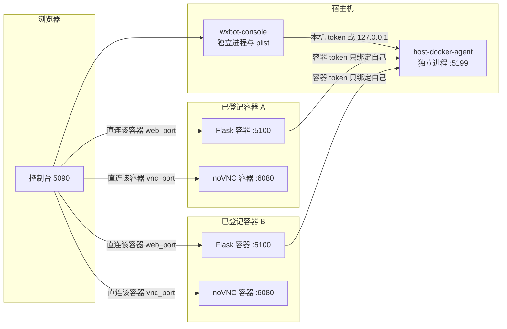
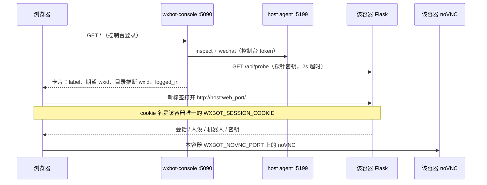

# 微信控制台：选号后进入该号后台与 VNC

| 字段 | 值 |
| --- | --- |
| 作者 | （待填） |
| 日期 | 2026-11-23 |
| 状态 | Draft |
| 范围 | 设计，不改代码 |
| 规模 | 现网 2 个号，近期上限 5 个。不是多租户 SaaS |

## Overview

每个微信已经是独立容器：容器内一份 Flask（`server.py`）只服务本容器的会话、人设、机器人和密钥，发送只走本容器 `DISPLAY=:0`（`docker/wx_send_legacy.py`）。这套隔离保持。缺的是一个不跟着某个微信重启而消失的入口。操作者先看到微信列表，点某一个，打开的就是这个容器自己的管理后台和这个容器已经映射出来的 noVNC。不能再串到另一个号。

入口放在宿主机上的独立控制台进程，不放进任何一个微信容器，也不和现有 docker agent 挤在同一个进程里。控制台只登记已经在跑的容器并生成链接。选中之后，页面仍由该容器的 Flask 提供，VNC 仍是浏览器直连该容器的宿主机端口。不合并进程、数据库或 DISPLAY。

## Background & Motivation

### 仓库里已经证实的行为

这些来自当前代码，不依赖某次 `docker inspect`。

- `server.py` 的 `_novnc_url()` 用 `{"5100": "6082", "5101": "6083"}`。未命中回退 `"6082"`。`WXBOT_NOVNC_URL` 或 `WXBOT_NOVNC_PORT` 可以覆盖。
- `static/index.html` 的 `VNC_BY_WEB` 把 `""` 和 `5100` 映到 `6082`、`5101` 映到 `6083`，并且只在返回 URL 的端口正好等于这张表时才覆盖扫码按钮。
- `core/desktop_management.py` 的 `DEFAULT_PROFILES` 只有 `primary` / `6082`。`_load_profiles()` 读容器内 `config.WORK_DIR/multi_accounts.json`（即 `<repo>/work/multi_accounts.json`）。文件缺失或为空时只回退 primary。`instances()` 在请求 Host 端口是 `5101` 时把整份列表改写成写死的 `second` / `6083`。`desktop_url()` 对非 loopback Host 返回 `{scheme}://{host}/vnc/...&path=vnc/websockify`，假设反代把 `/vnc/` 转到 `6082`。`selected_profile()` 信任 `?instance=`。缺省 `vnc_port` 是 `6082`。
- `probe()` 调 `docker inspect`，进程检查是 `docker exec <container> pgrep -x wechat`。容器内没有 docker 时 `FileNotFoundError` 把 `error` 清成 `None`，`wechat_running` 保持 false。`static/desktop.html` 在非 2xx 时显示「后台状态读取失败」；200 且进程为假时显示「桌面未运行」或「桌面已启动 · 微信未运行」。空 `error` 不会变成前一句。
- `core/docker_wx.py` 的 `wechat_running()` 用的是另一条命令：`pgrep -f /opt/wechat/wechat`。`container_wxid()` 是 `xwechat_files/<name>/db_storage/contact/contact.db` 里 mtime 最大的目录名，不是登录票据。`logged_in()` 为真仅当这个目录存在且上述 `pgrep -f` 成功。同文件 `capture_img_key` 里另有 `pgrep -x wechat`，那是抓密钥，不是状态页。
- `core/multi_account.py` 的 `REGISTRY` 是容器内 `work/multi_accounts.json`。`list_accounts()` 只在表为空且 `WXBOT_MULTI_INCLUDE_LEGACY=1`（默认）时合成一条 legacy primary：`wxbot-ubuntu-manual` / `5100` / `6082`，状态写死 `managed_externally` / `running=True`，不 inspect。表非空时不再合成 primary。`create()` 只追加 JSON，端口是 `BASE_WEB + len(accounts) + 1`（默认基线 5100，空表第一条是 5101），不创建容器。`action()` 没有 docker CLI 时只走 `WXBOT_HOST_AGENT_URL`（默认 `http://host.docker.internal:5199`）。
- `SELF_CONTAINER` 有两个缺省，不是同一个值。`core/multi_account.py` 代码缺省是 `wxbot-ubuntu-manual`。`docker-compose.yml` 把 `WXBOT_SELF_CONTAINER` 设为 `${WXBOT_SELF_CONTAINER:-wxbot}`。`tools/install_host_agent.sh` 在 `.env` 没有该键时写入 `WXBOT_SELF_CONTAINER=wxbot`。运行中的容器到底哪一个生效，要看该容器的 env，不能用代码缺省代替。
- `server.py` 第 22–24 行：`secret_key` 是 `WXBOT_SECRET or WXBOT_ADMIN_READ_TOKEN or os.urandom(32)`。未设置 `SESSION_COOKIE_NAME`，Flask 默认 `session`。只开了 `HttpOnly` 和 `SameSite=Lax`。host-only cookie 不把端口算进身份，所以同一 hostname 上的 `5100` 和 `5101` 会互相带上、互相覆盖这条名为 `session` 的 cookie。
- `local_management_access()` 在 `WXBOT_LOCAL=1` 时直接返回 True。`docker/ubuntu-manual/compose.yaml` 默认 `WXBOT_LOCAL:-1`。因此容器内 `/api/accounts*` 的 `_accounts_auth()` 不需要 admin token。
- `static/accounts.html` 把后台和 VNC 写成 `http://127.0.0.1:${port}`。`static/nav.js` 写死六个相对链接，每 5 秒拉 `/api/auth/status`，401 才跳登录；它不读 `/api/status`。
- `tools/host_docker_agent.py` 绑定 `0.0.0.0:5199`。`OPS` 只有 `start` / `stop` / `restart` / `inspect`。token 在 body 里，`compare_digest` 只比对 token，不绑定容器名。`NAME_RE` 是 `^wxbot(-[a-z0-9][a-z0-9-]*)?$`。`tools/install_host_agent.sh` 的 LaunchAgent 是单进程、`KeepAlive=true`。
- `docker-compose.yml` 有 `extra_hosts: host.docker.internal:host-gateway`。`docker/ubuntu-manual/compose.yaml` 没有 `extra_hosts`，端口发布是 `127.0.0.1:5100`、`6082`、`5902`，卷名 `wxbot-ubuntu-manual-home`，并把 `../../accounts` 挂到 `/app/accounts`。仓库里没有 second 容器的 compose。

### 落地时用 docker inspect 填的表

下面这张表不是仓库事实。控制台 adopt 时只把 `docker inspect` / `docker port` 读到的字段写入注册表。wxid 和显示名由操作者确认后另记。对不上就拒绝，不用本文的字面量当生产数据。

| 字段 | 从哪读 | 操作者另填 |
| --- | --- | --- |
| 容器名 | `docker inspect` 的 Name | 显示名 label |
| 宿主机 web / noVNC / RFB 端口 | `docker port` | 无 |
| 卷、hostname、MacAddress | `docker inspect` | 无 |
| 代理 env | `Config.Env` 里实际出现的 `http_proxy` / `HTTP_PROXY` | 无；没有就记 null，不要抄文档 |
| 数据目录推断 wxid | 该容器 `/api/identity`（见下） | `expected_wxid`，必须操作者确认 |
| `WXBOT_SELF_CONTAINER` | 该容器 env | 若与容器名不一致，登记为待修正，不改写成「已经是某值」 |

现网对照只作为 adopt 前的人工核对清单，不写进仓库：显示名、wxid、容器名和端口以当时的 `docker inspect` / `docker port` 为准。仓库不能证实 second 的容器名、端口、wxid、MAC、hostname、代理和 `extra_hosts`。两个容器是否共用同一对 `WXBOT_UI_USER` / `WXBOT_UI_PASSWORD`，只有在它们实际加载了同一份 env 时才成立，代码并不强制。

### 已经踩过的串号

从第二个管理口打开页面时，写死的 `localhost:6080` 或回退到 `6082` 会打开第一个微信的登录码。`5101` 特判、`VNC_BY_WEB` 和 `_novnc_url()` 的端口表是同一类补丁：只认识现在这两个 Web 端口，第三个号还会错。`desktop.html` 又把注册表里每一条的 `desktop_url` 直接设成 iframe。只要容器内 `work/multi_accounts.json` 有两条，`?instance=` 就能在一个管理口上打开另一个号的 VNC。`sessionStorage` 按 origin（含端口）隔离，挡不住同页选错 id。

`docs/multi-account-management.md` 已把「每号一个容器、一个卷、一个后台端口、一个 VNC 端口」写成运行模型，并指出管理 API 应放到宿主进程。本设计是入口层，不是把两个号收进一个 Flask。

## Goals & Non-Goals

### Goals

- 一个入口列出当前微信。现在按已登记的两个容器，以后最多 5 个，仍是同一张表。
- 点某个号之后，会话、人设、机器人、密钥和 VNC 都只属于这个容器。
- VNC 使用 `docker port` 登记的宿主机端口，hostname 取当前页面的 hostname。禁止写死 `localhost:6080`，禁止未配置时回退 `6082`。
- 登记已经在跑的容器，不删、不重建。
- 容器内没有 docker CLI 时，容器状态仍能从宿主机 agent 拿到，且停控制台不影响 agent。
- 顶栏同时给出数据目录推断 wxid 和 `logged_in`。推断值与期望值不一致时，本容器拒绝发送。
- 登录 cookie 不再在不同管理口之间互相覆盖，签名密钥也不再共用。

### Non-Goals

- 不把两个微信合成一个进程、一个数据库、一个 `DISPLAY`。
- 不把发送放进控制台。`docker/wx_send_legacy.py` 继续只操作本容器 `DISPLAY=:0`。
- 不做多租户 SaaS。
- 本设计不实现。落地拆到文末 PR Plan。
- 不改 machine-id、MAC、hostname、代理。
- 不做公网无认证暴露。管理口和 noVNC 保持现有 loopback 发布。
- 本轮不把 `accounts/` 整树挂载收成单 wxid 子目录。密钥文件跨容器可读是已知风险，单独排期。

## 备选方案

### 方案 A：继续两个端口，只修链接

浏览器仍分别打开两个管理口。修掉 `accounts.html` 的 `127.0.0.1`、`desktop_url()` 的 `/vnc/` 回退、`?instance=` 和 cookie 同名。

- 优点：不新增进程，串桌面可以先堵住。
- 缺点：没有「一个入口」。列表若放在某个微信容器的 `/accounts` 上，这个容器一停入口就没了。端口特判会留下来。
- 结论：不作为产品形态。其中「本容器只嵌自己的 VNC」和 cookie 拆分仍然要做，见 PR2、PR3。

### 方案 B：浏览器只开一个端口，后台反代到选中容器

控制台把 `/wx/<id>/` 反代到该容器管理口，把 `/vnc/<id>/` 反代到该容器 websockify。

- 优点：书签只有一个；公网只暴露一个上游。
- 缺点：要改写 noVNC 的 `path=websockify`、iframe 绝对 URL、升级头和 `Set-Cookie` Path。`desktop_url()` 已经把公网 Host 收成一条 `/vnc/`，这条假设会把第二个号送到第一个桌面。5 个号的连接数用反代没有收益。
- 结论：不推荐。

### 方案 D：同一份安装、两个进程

`5199` 维持现有短生命周期 docker helper。`5090` 是另一个进程，只读自己的注册表，状态查询调本机 docker 或带自己 token 调 `5199`。页面不进 agent 进程。

这不是推荐方案的反面，而是推荐方案的进程模型。把它单独写出来，是为了拒绝「同一个 Python 进程里挂两个 `ThreadingHTTPServer`」。同进程时，控制台启动失败、`5090` 被占用、adopt 抛错或页面线程里没接住的异常，仍然可以让 `launchd` 把正在执行 `stop` 的 agent 一起重启。两个 `serve_forever` 也不能让 `launchctl unload` 只停其中一个。

### 推荐：方案 C，独立控制台 + 直连已发布端口



选中某个号时控制台不做应用层反代。它返回：

- `admin_url = http://{页面 hostname}:{web_port}/`
- `vnc_url = http://{页面 hostname}:{vnc_port}/vnc.html?autoconnect=true&resize=scale&path=websockify`

端口来自 adopt 时核对过的 `docker port`。hostname 用页面 Host 解析出的 hostname，不用 `127.0.0.1`，也不用容器内的 `6080`。`static/nav.js` 的相对链接留在这个 origin 上。

为什么是这个：隔离已经由 Docker 端口映射完成。控制台只解决找得到、对得上号、停了一个微信入口还在。视频路径不进控制台。2 到 5 个号的运维成本是一张有上限的 JSON 表，不是一套路由。进程拆开之后，停控制台不会卸掉 `5199`。

## Proposed Design

### 组件

| 组件 | 跑在哪 | 职责 | 不做什么 |
| --- | --- | --- | --- |
| `wxbot-console` | 宿主机独立进程，`127.0.0.1:5090`，独立 plist `com.wxbot.console` | 登录、列表、adopt、拼链接、聚合健康 | 不解密、不发送、不 `sys.exit` agent |
| host agent | 现有进程，plist `com.wxbot.host-docker-agent` 保持单职责 | 白名单 docker 操作 | 不提供页面，不读控制台注册表来决定听不听 |
| 容器 Flask | 各容器 `0.0.0.0:5100` | 现有后台；身份与发送闸门 | 不列出别的号，不代理别的 VNC |
| noVNC | 各容器 `6080`，宿主映射端口以 `docker port` 为准 | 该容器桌面 | 不共用一条 `/vnc/` |

`install_host_agent.sh` 继续只安装 agent。控制台另有安装步骤，复制的是控制台脚本，不是把页面塞进 `host_docker_agent.py`。`KeepAlive` 各自生效：agent 崩溃只重启 agent，控制台崩溃只重启控制台。

控制台停止的定义是 `launchctl unload ~/Library/LaunchAgents/com.wxbot.console.plist`（或等价地停这个进程）。禁止用 unload `com.wxbot.host-docker-agent` 来「关控制台」。

### 注册表现有容器

不要调用 `multi_account.create()`。空表时它会把第一条写成 `5101`，`container` 还会变成 `wxbot-<slug>`，和已经发布的端口对不上，而且它不创建容器。

登记源只有宿主机 `~/.wxbot/console/registry.json`。不把这份文件投影进容器 `work/multi_accounts.json`。容器内那份文件一旦非空，`list_accounts()` 就不再合成 legacy primary，回滚时 primary 会从容器内列表消失。PR6 之前，容器内 `/api/accounts*` 改为只读拒绝写操作（见安全节），避免两份表同时能 stop。

adopt 输入是容器名。服务端执行：

1. `docker inspect` 取 Name、State、HostConfig.Binds / Mounts、Config.Hostname、MacAddress、Config.Env。
2. `docker port <name>` 取宿主机端口。管理口必须是容器 `5100` 的宿主映射；noVNC 必须是容器 `6080` 的宿主映射；RFB 必须是容器 `5900` 的宿主映射。缺任何一条就拒绝。
3. 与请求里操作者填写的 `label`、`expected_wxid` 一起写入。wxid 不允许从文档字面量自动填。label 为空拒绝。
4. 同 id 已存在时只更新本次 inspect 到的运行时字段（端口、卷、hostname、mac、代理 env）。`label` 与 `expected_wxid` 已有非空值时不覆盖，除非请求带 `replace_identity=true`。空字符串不算「已有值」。
5. 文件锁：`fcntl.flock` 包住读-改-写，临时文件仍用 `os.replace`。锁文件是 `~/.wxbot/console/registry.lock`。
6. 注册表 `accounts` 长度达到 5 则拒绝下一次 adopt。已有 5 条时只能改字段，不能再增。

不在启动时发现「缺少 primary / second 这两个 id」就写入任何显示名或人设名。自动写入会把未核实的 wxid、MAC、代理当成生产数据。首次打开控制台若表为空，页面列出 `docker ps --filter name=^wxbot` 的候选容器，每条显示 inspect 到的端口和 hostname，操作者点「登记」并填写 label 与期望 wxid。

建议字段：

```json
{
  "version": 1,
  "accounts": [
    {
      "id": "由操作者给的 slug",
      "label": "操作者确认的显示名",
      "expected_wxid": "操作者确认后写入",
      "container": "inspect 到的名字",
      "web_port": 0,
      "vnc_port": 0,
      "rfb_port": 0,
      "volume": "inspect 到的卷名",
      "hostname": "inspect 到的 hostname",
      "mac": "inspect 到的 MacAddress",
      "proxy": "env 里的代理或 null",
      "enabled": true,
      "adopted": true
    }
  ]
}
```

`web_port`、`vnc_port`、`rfb_port` 在表内唯一，且不得是 `5090` 或 `5199`。`adopted: true` 表示控制台不 `docker run`、不重建。

容器内 `_load_profiles()` 不再读多账号 JSON 来决定 VNC。桌面只认本容器环境变量。完整列表只在控制台。

### 进入某个号



容器顶栏数据只来自 `GET /api/identity`，不从 `/api/status` 再长一套平行字段。`/api/status` 保持现有机器人、密钥、同步字段；其中的 `logged_in_wxid` 改名为响应里的兼容别名一轮，新客户端只读 `/api/identity`。

`/api/identity` 走用户登录，返回：

```json
{
  "label": "来自 WXBOT_ACCOUNT_LABEL",
  "expected_wxid": "来自 WXBOT_EXPECTED_WXID",
  "inferred_wxid": "container_wxid()，可能是残留库",
  "logged_in": false,
  "wechat_running": false,
  "match": false,
  "container": "WXBOT_SELF_CONTAINER",
  "web_port": 5100,
  "vnc_port": 6082
}
```

`inferred_wxid` 的含义就是 `container_wxid()`：数据目录里 contact.db mtime 最新的那个名字。它不是「当前登录 wxid」。`match` 仅当 `expected_wxid` 非空、`inferred_wxid` 与之相等、且 `logged_in` 为真。未登录、目录为空、或只是残留库更新，都是 `match=false`。

顶栏文案：

- `match=true`：`{label} · 已登录 {inferred_wxid} · 容器 {container} · 本页 :{web_port}`
- `logged_in=false`：`{label} · 未登录 · 目录推断 {inferred_wxid 或「无」} · 期望 {expected_wxid}`
- 已登录但 wxid 不一致：红字 `目录推断 wxid 与期望不符，本容器已拒绝发送`

不一致时不是只改颜色。判断只有一个函数，放在 `core/account_session.py` 旁的新模块不行，调用方会漏。判断写在 `core/docker_wx.py` 的 `require_identity_match()`，因为本容器所有会点、会打字的路径最终都进了这个文件的 `UI_LOCK`、`_exec` 或 `wx_send.py`。`match=false` 时它抛 `IdentityMismatch`。身份每轮现算，不缓存「启动时曾经匹配」。

必须在真正点击或提交之前调用它的位置，按仓库里的函数名：

- `core/sender.py` 的 `_send()`：在 `docker_wx.request_priority()` 之前返回 `not_sent` / `identity_mismatch`。`send_text`、`send_image`、`send_at` 都只是调用 `_send`；`send_relay` 调用 `send_text`。只改那四个公开函数盖不住 `retry()`，因为 `retry()` 直接调用 `_send()`。`core/bot.py` 和 `core/schedule.py` 的 `fire()` 都会 `sender.retry()`。
- `core/sender.py` 的 `send_webhook()`：不进 `_send()`。在 `ledger.claim` 之前做同一判断，拒绝则不发 HTTP。
- `core/legacy_sender.py` 的 `LegacySearchAdapter.submit()`：`_send()` 在 adapter 是 `LegacySearchAdapter` 时第一行就 `return _adapter.submit(...)`，根本不会走到 `_send()` 后半段。`submit()` 必须在 `docker_wx.request_priority()` 之前拒绝。它后面会 `docker_wx._exec('python3', wx_send_legacy.py, ...)`。`_leave_search_ui()` 里的 Escape 只允许在这次 `submit()` 已经因为超时或焦点失败而进入清理时执行；新的一次发送不能靠清理路径开头。
- `core/sendq.py` 的 `_run()` 调用 `sender.send_text` / `sender.send_image`，因此经过 `_send()`。另外若 `res['retryable']` 为真，现在会 `threading.Timer` 再把同一条放回队列。身份不匹配时 `_run()` 不得再入队。
- `core/docker_wx.py` 里会执行 `wx_send.py` 或 `xdotool` 的函数，在拿 `UI_LOCK` 之前拒绝：`open_chat`（`justopen`）、`search_query`（`searchquery`）、`click`（`clickxy`）、`title_shot`（`titleshot`）。`_capture_img_key_locked` 里 `DISPLAY=:0 xdotool mousemove/click` 那段同样先拒绝。`paste_text`、`paste_at`、`paste_image_open`、`send_text`、`send_image` 只是转到 `sender`，由 `_send()` 挡住，不在这里再包一层可被绕过的空判断。
- `core/moments_jobs.py` 不经过 `sender` 的四个函数。`refresh()` 在 `UI_LOCK.acquire` 之前拒绝，因此不会调用 `moments_native.Native.refresh()`。`process_one()` 在 `UI_LOCK.acquire` 之前拒绝，因此不会执行 `Native()`、`prepare_comment`、`prepare_like`、`prepare_publish`、`submit()`。`moments.start_loop()` 本身不提交，挡住 `process_one` 和 `refresh` 才挡住朋友圈点击。点赞后的 `_process_chat` 走 `sender.send_text`，仍由 `_send()` 挡住。
- `core/moments_native.py` 的最低入口是 `Native.run()`，不是 `Native.click` / `Native.key`。`open()`、`refresh()`、`_reveal_actionbar()`、滚动到评论、`prepare_publish()` 和 `cleanup()` 直接 `self.run('xdotool', 'windowactivate'|'mousemove'|'click'|...)`，不经过 `click()` / `key()`。`Native.run()` 在 `subprocess.run` 之前看 argv：`xdotool` 的 `mousemove`、`click`、`key`、`windowactivate`、`type` 拒绝。因此 `cleanup()` 里的 Escape、点输入框和回删也会停。只读可以过：`xdotool getactivewindow`、`getwindowpid`、`getwindowgeometry`，以及 `wmctrl -lp`、`pgrep`、`scrot`、`tesseract`。`Native.click` / `key` / `submit` 不再单独当兜底，因为它们只是 `run` 的上层。
- `core/native_ui.py` 里模块级 `key()` 和 `click()` 只存在于内嵌 `HELPER` 字符串和文件顶部的同名函数；`NativeContactAdapter` 不调用它们。它调用 `NativeUI.call('key'|'click'|'scroll'|'stage'|'send_once'|'discard_stage'|...)`，由 `HELPER` 在子进程里自己跑 `xdotool`。闸门放在 `NativeUI.call()`：action 属于 `click`、`key`、`scroll`、`stage`、`send_once`、`discard_stage`、`copy_field`、`read_input`、`restore` 时，在 `subprocess.run` 之前拒绝。`state`、`shot`、`fingerprint`、`clipboard` 只读，放行。只改模块级 `key()` / `click()` 挡不住这条路径。`moments_native.run` 和 `NativeUI.call` 都是本地 `subprocess`，不进 `docker_wx._exec`。

HTTP 409 只是外层，覆盖 `/api/send`、`/api/greet`、`/api/bot/push`、`/api/bot/push/test`、`/api/schedule/<id>/run`、`core/moments_api.py` 的草稿 `submit` 和 `retry`。只拒绝「机器人 start」不够：`server.py` 的 `main()` 在 `WXBOT_BOT_AUTOSTART=0` 时仍会 `_start_bot()`。

`match=false` 期间，回复循环打到 `_send()` 就停，日志 `identity mismatch; send skipped`。已经进 `sendq` 的任务在 `_run()` 里结束为 `not_sent`，不再 Timer 重试。定时 `fire()` 里的 `sender.retry()` 同样停在 `_send()`。朋友圈任务停在 `process_one()`，不进入 `initiated`。不把线程杀掉；下一次 `match=true` 自动恢复。不另做一个可选 wrapper：上面列出的函数各自先调用 `docker_wx.require_identity_match()`，漏掉其中一个就还能点微信。

控制台不拦截发送，因为它不在这条路径上。期望 wxid 配错会让该容器的自动回复、定时和朋友圈一起停，这是故意的：配错或残留库比把消息发进当前登录号更显眼。操作者改 `WXBOT_EXPECTED_WXID` 后重启该容器即可恢复，不提供页面上的「忽略不一致」。

`static/nav.js` 账号条链回 `location.protocol + '//' + location.hostname + ':' + consolePort`。`consolePort` 来自 `/api/identity` 的 `console_port`（环境变量 `WXBOT_CONSOLE_PORT`，缺省不猜，链接隐藏）。`/api/auth/status` 返回 401 时只跳登录，不先擦掉账号条再闪一下；身份请求失败时保留上一笔成功的账号条，旁边标「身份刷新失败」。不要在 401 轮询里把账号条清空。

必须改 `<title>` 和页眉的页面：`static/index.html`、`static/desktop.html`、`static/accounts.html`、`static/moments.html`、`static/personalization.html`、`static/battle.html`。标题格式 `{label} · wxbot`。`desktop.html` 的 footer 删掉「切换实例只切换所查看的桌面」。只改 `nav.js` 不够，这些页有自己的 header。

`static/accounts.html` 变成「本机容器」：删掉添加微信号、批量启停、管理员 Token 表单和 `X-Wxbot-Admin-Token` 内存态。这页只显示本容器的 inspect 结果和「打开控制台」。跨号启停只留在控制台。它和 UI 登录 cookie 是同一条鉴权，不再保留第二套 Token 门。

### VNC 地址

每个容器在删除端口猜测之前就设好 `WXBOT_NOVNC_PORT`，值等于 `docker port` 看到的宿主 noVNC 端口。没设之前，代码保留现有 `5100/5101` 特判，不先删。

设置并在容器内验证之后，`server._novnc_url()` 改为只读该环境变量。未配置返回空字符串，不回退 `6082`。Host 解析见下一节，不用 `rsplit(":", 1)`。

`static/index.html` 删除 `VNC_BY_WEB`。只接受 `/api/identity` 给出的 `vnc_url`，并且要求解析后的 hostname 等于 `location.hostname`、端口等于 `vnc_port`。空 URL 时扫码按钮禁用，文案「本容器未配置 VNC 端口」。iframe 不设置 `src`。

`desktop_management` 同一改动里：

- `selected_profile()` 忽略 `request.args` 的 `instance`，也忽略 body。只返回本容器这一条。
- `/api/desktop/instances` 只返回这一条。不再读 `work/multi_accounts.json` 的其它账号，不再因为 Host 端口是 `5101` 改写整表。
- `desktop_url()` 只用 `WXBOT_NOVNC_PORT`。删除公网 `/vnc/` 分支和 `{"5100": 6082, "5101": 6083}`。
- `static/desktop.html` 去掉下拉，不读 `sessionStorage['wxbot.desktop.instance']`。

公网若以后要反代，必须按号配置完整的 `WXBOT_PUBLIC_NOVNC_URL`。本轮不实现。控制台生成的 `admin_url` / `vnc_url` 固定 `http`，不读 `X-Forwarded-Proto`。前面即使有 TLS 终止，这些链接仍是 http 直连宿主端口。页面若是 https，浏览器会把这种链接当成主动打开的新标签，而不是在 https 页面里混用；桌面 iframe 在 https 控制台上嵌 http 会被拦截，所以控制台不嵌 iframe，只给「打开桌面」链接。这一点写进控制台空状态，避免操作者以为协议会跟着页面走。

### Host 解析

`request.host` 对 IPv6 可能是 `[::1]:5100`。`rsplit(":", 1)[0]` 会得到 `[::1`，拼出来的 URL 是坏的。现有 `_novnc_url()` 和 `desktop_url()` 也是这种切法，一并换掉。

```python
from urllib.parse import urlsplit

def page_hostname():
    host = request.host or ""
    if host != host.strip() or "/" in host or "@" in host or "\\" in host:
        return None
    name = urlsplit("//" + host).hostname
    if not name or name == "0.0.0.0":
        return None
    if any(c in name for c in " /?#@"):
        return None
    return name

def http_origin(port):
    name = page_hostname()
    if not name or not port:
        return ""
    bracket = f"[{name}]" if ":" in name else name
    return f"http://{bracket}:{int(port)}"
```

只允许这段函数产出的 hostname。拒绝空 Host、`0.0.0.0`、带用户信息、带路径。IPv6 输出必须是 `[addr]:port`。单测覆盖 `127.0.0.1:5100`、`localhost:5101`、`[::1]:5100`，以及无端口的 `[::1]`。`.local` 和普通局域网主机名允许，因为目标就是从非 localhost 打开时仍指向同一台机器，而不是操作者自己的环回。不接受把 hostname 改写成 `127.0.0.1`。

### 容器内没有 docker CLI 时的状态

两条失败不要写成同一种文案：

| 情况 | `probe()` 的 error | 页面 |
| --- | --- | --- |
| HTTP 非 2xx 或网络失败 | 请求没拿到 JSON | 维持现有「后台状态读取失败」 |
| agent 不可达或无 token | `宿主状态服务不可用` | 这句原文，不得显示「桌面未运行」 |
| inspect 到容器没在跑 | `None`，`container_running=false` | 「桌面未运行」 |
| 容器在跑、`pgrep` 返回 1 | `None`，`wechat_running=false` | 「桌面已启动 · 微信未运行」 |
| `pgrep` 返回其它码或超时 | `暂时无法检查微信进程` | 这句，不把它当成未运行 |

agent 新增 `op=wechat` 时，服务端固定执行与 `docker_wx.wechat_running()` 相同的探测：`docker exec <container> pgrep -f /opt/wechat/wechat`，超时 4 秒。返回码 0 是在跑，1 是没在跑，其它是错误。不允许调用方传入命令行。不要用 `pgrep -x wechat`：`-x` 对不上带路径的命令行时会永远 `running: false`，桌面页就会显示「桌面已启动 · 微信未运行」。`desktop_management.probe()` 里现有的 `-x` 在改为走 agent 时一起改成 `-f`。

`probe()` 不再吞 `FileNotFoundError`。没有 docker CLI 就走 agent；agent 失败时 error 必须是「宿主状态服务不可用」。补测试：容器内无 docker、agent 不可达时，页面文案不得是「桌面未运行」。

微信是否登录仍只信本容器 `/api/identity` 的 `logged_in`。agent 的 `wechat` 只表示进程在。

### agent 监听与调用来源

不要先把 `5199` 绑死 `127.0.0.1`。容器访问 `host.docker.internal` 到达的是 Docker Desktop 或 Linux `host-gateway` 的网关地址，不是宿主进程眼里的 `127.0.0.1`。绑死 loopback 后，容器内探针会一直是「宿主状态服务不可用」。

选定规则：

- agent 继续听 `0.0.0.0:5199`，否则容器经 gateway 连不上。
- 过滤的是宿主 `accept()` 得到的 peer，不是容器里 `getpeername()` 看到的对端。容器访问 `host.docker.internal:5199` 时，容器看到的是网关；宿主看到的是该容器在桥上的地址。把网关放进允许表会拒绝合法探针。不要把网关 IP 当作容器源。
- 允许表只有三类：`127.0.0.1`、`::1`、以及本机 docker 网络里的容器地址。地址来自 `docker network inspect` 的 `Containers[].IPv4Address`（已登记容器优先；候选 `wxbot*` 的 IP 也列入，否则 adopt 前的健康检查没有源地址）。对应网络的 `IPAM.Config.Subnet` 仅作为这些 IP 的校验范围，不把整个子网永久放行到公网接口；peer 必须落在该 Subnet 内且等于某个当前容器 IP。容器重建后 IP 会变，agent 每 30 秒刷新一次允许表，并在每次拒绝时再刷新一次。
- 例子只说明 peer 是谁，不是要写死的地址。Docker Desktop 上，容器看到的网关可能是 `192.168.65.254`，宿主 `accept()` 的 peer 可能是 `192.168.65.3` 这种容器地址。Linux `host-gateway` 上，容器看到的是桥网关（常见 `172.17.0.1`），宿主 `accept()` 的 peer 是该容器的桥 IP（常见 `172.17.0.2`）。`192.168.65.1` 不作为允许项，除非某次 `docker network inspect` 证明它是容器 IP 而不是网关。
- 健康检查失败时，日志打出这次 `accept()` 的实际 peer 和当时的允许表。primary 没有 `extra_hosts` 时，容器内可能解析不了 `host.docker.internal`；这种失败是 DNS/网关配置问题，不是 peer 表问题。安装脚本在容器外打印的是 inspect 到的容器 IP，不从容器内 `getpeername` 反推。
- 不依赖操作者手写 `iptables` / `DOCKER-USER` 才算安全。有防火墙可以再加一层，但设计的强制点是进程内来源检查。
- 健康检查两条都要过：宿主机 `curl http://127.0.0.1:5199/health`，以及从每个已登记容器内 `curl http://host.docker.internal:5199/health`。primary 的 `docker/ubuntu-manual/compose.yaml` 没有 `extra_hosts`，PR4 给它加上。second 没有仓库 compose，PR4 以该容器 `docker inspect` 的 `ExtraHosts` / `HostConfig` 为准；缺了就在不重建镜像的前提下给运行配置补 `host-gateway`，而不是假设仓库里有一份文件。

token 分成两份，都用 `compare_digest`：

| token | 谁持有 | 允许的容器名 |
| --- | --- | --- |
| 容器 token | 各容器 `WXBOT_HOST_AGENT_TOKEN` | 服务端绑定表：这个 token 只能操作列出来的容器名。现网每个容器一份自己的 token，绑定 `WXBOT_SELF_CONTAINER` 修正后的真实容器名。body 里的 `container` 必须等于该绑定，否则 403 |
| 控制台 token | 只在宿主机 `~/.wxbot/console/agent.token`，不进任何容器 | 可操作注册表里的 `wxbot*`。仅当 TCP 对端是 `127.0.0.1` 或 `::1` 时接受 |

被攻破的容器改 body 里的容器名不能停另一个号，因为容器 token 在服务端绑死了。控制台不能靠「同进程直接调函数」绕过，因为已经是两个进程；它走 loopback + 控制台 token。容器内 Python 即使传了别的名字也没有用。

`install_host_agent.sh` 今天会在 `.env` 缺键时写入 `WXBOT_SELF_CONTAINER=wxbot`。PR4 改掉这个默认值，改为不自动写 `wxbot`。primary 的 env 修正为 `docker inspect` 到的容器名（仓库 compose 里的 `container_name` 是 `wxbot-ubuntu-manual`）。在这个 env 修正并验收之前，控制台不提供 stop / restart。start 可以有。stop 白名单在修正前为空，不是「先上按钮再提醒」。

### 登录与 Cookie

只改 cookie 名不够。浏览器本来就不会把 `wxbot_primary` 发给另一个端口，所以「用 primary 的 cookie 值访问 second」测不到签名是否被接受。两边 secret 相同的时候，把签好的会话改名成对方的 cookie 名，对方会接受。

`secret_key` 回退链今天会让问题更隐蔽：second 只换了 `WXBOT_SECRET`，却继续共享 `WXBOT_ADMIN_READ_TOKEN` 时，密钥仍然相同。`os.urandom(32)` 则每次重启都变，会话无法验收。

规则：

- 每个容器必须设置唯一的 `WXBOT_SESSION_COOKIE`。未设置则 Flask 拒绝监听并退出，日志写明缺的变量。禁止缺省成共享的 `session` 或 `wxbot_session`。控制台固定 `wxbot_console`，这个名字不发给容器。
- 每个进程的 `secret_key` 只读自己的文件：容器是该容器 env 指向的 `WXBOT_SECRET_FILE`（权限 `0600`，不进镜像），控制台是 `~/.wxbot/console/secret`。禁止回退 `WXBOT_ADMIN_READ_TOKEN`，禁止 `urandom`。文件缺失则拒绝启动。
- 现有 `WXBOT_SECRET` 环境变量若与文件不一致，以文件为准；迁移时把当前该容器正在用的 secret 写入它自己的文件，不把 primary 的文件复制给 second。
- 响应里对历史名 `session` 送 `Set-Cookie: session=; Max-Age=0; Path=/; HttpOnly; SameSite=Lax`，避免旧 cookie 在忘配时继续被默认名接受。
- `WXBOT_UI_USER` / `WXBOT_UI_PASSWORD` 可以仍是同一对口令。那只是登录口令，不是票据。各容器仍然各登一次。控制台可以在首次安装时复制这组口令作为初始值，但不得复制 secret 文件。
- 控制台 secret 缺失不得回退到任何一个容器的 secret。

验收：

1. 在管理口 A 登录后，打开管理口 B 的请求不带 A 的 cookie。
2. 把 A 签好的会话值改成 B 的 `SESSION_COOKIE_NAME` 再请求 B，必须 401。
3. 未设置 `WXBOT_SESSION_COOKIE` 的进程不能完成 bind。

### 控制台如何知道是哪一个号

卡片显示 label、`expected_wxid`、容器名、`docker port` 得到的端口。实报字段改名为「目录推断 wxid」，旁边显示 `logged_in`。不要把 `container_wxid()` 叫成已登录 wxid。

控制台每 10 秒拉 `GET /api/probe`，不是拉 `/api/status`。`/api/status` 在 `require_ui_login()` 后面，控制台没有该容器的用户 cookie，未登录只能拿到 401，无法区分「没人登录」和「后台挂了」。

`/api/probe` 不使用用户 session。请求头 `X-Wxbot-Probe-Token` 与该容器的 `WXBOT_PROBE_TOKEN` 做 `compare_digest`。token 由控制台 adopt 时生成，写入注册表旁的 `~/.wxbot/console/probes/<id>.token`（`0600`），并注入该容器 env。不要复用 `WXBOT_ADMIN_READ_TOKEN`，也不要复用 host agent token。响应只有：

```json
{
  "ok": true,
  "logged_in": false,
  "inferred_wxid": null,
  "wechat_running": false,
  "identity_match": false
}
```

超时 2 秒记「后台不可达」。401/403 记「探针被拒绝」，不记成不可达，也不沿用上一笔 wxid。`logged_in=false` 且 HTTP 200 记「未登录」。

身份比对在卡片上告警。真正停发的是上一节列出的点击和提交入口，都调用 `docker_wx.require_identity_match()`。HTTP 409 只是外层。控制台红卡片不能代替这个闸门。已入队的 `sender.retry()`、`sendq._run()`、`LegacySearchAdapter.submit()`、`moments_jobs.process_one()` 和 `docker_wx` 的 `wx_send.py` 点击走同一判断。

### 容量与延迟

- 账号数：adopt 硬上限 5。注册表小于 10 KiB。
- `GET /api/accounts` 的状态刷新用上限为 5 的线程池。每个下游 `urllib` 超时 2 秒，到点就放弃该号，不占用别的号的名额。一个容器 TCP 挂起不会占满控制台：池外不再为同一轮新开线程，该轮最多 5 个 in-flight。控制台工作线程与 agent 无关。
- 容器页现有轮询保持：`nav.js` 5 秒一次 auth status，桌面 10 秒一次。不再加跨号轮询。
- noVNC 仍是浏览器直连宿主端口。控制台挂了不影响已打开的号，也不影响 `5199`。

## API / Interface Changes

### 控制台 `127.0.0.1:5090`

| 方法 | 路径 | 行为 |
| --- | --- | --- |
| `GET /` | 登录后的列表 | 候选容器与已登记卡片 |
| `POST /api/auth/login` | 控制台口令 | cookie 名 `wxbot_console` |
| `GET /api/accounts` | 注册表 + 本轮新鲜探针 | 线程池，单号 2 秒；含 `admin_url`、`vnc_url`、`inferred_wxid`、`logged_in` |
| `POST /api/accounts/adopt` | 登记已存在容器 | 只接受容器名、id、label、expected_wxid；服务端 inspect。超过 5 条拒绝 |
| `POST /api/accounts/<id>/start` | 转给 agent | 修正 `SELF_CONTAINER` 之前也允许 |
| `POST /api/accounts/<id>/stop\|restart` | 转给 agent | 仅当该容器 env 的 self 名已等于 inspect 名，且 body `confirm_wxid` 等于 `expected_wxid` |

链接只用 `http_origin()`。禁止从 JSON body 接收 URL。scheme 固定 http。

### 容器 Flask

| 现有 | 之后 |
| --- | --- |
| 未设 cookie 名，默认 `session` | 未设 `WXBOT_SESSION_COOKIE` 则拒绝启动；响应清除 `session` |
| `secret_key` 回退 admin token 或 urandom | 只读本容器 secret 文件 |
| `GET /api/desktop/instances` 可返回多条并信任 `?instance=` | 忽略 `instance`，只返回本容器，URL 只用 `WXBOT_NOVNC_PORT` |
| `GET /api/accounts` 在空表时合成 primary，非空则不再合成 | PR6 前写操作全部 403；读只返回本容器。之后跨号列表只在控制台 |
| `/api/status` 的 `logged_in_wxid` 被当成实报登录号 | 新字段只放在 `/api/identity`；探针走 `/api/probe` |
| `WXBOT_LOCAL=1` 时 `/api/accounts*` 免 token | 即使免 UI token，stop/restart/batch 只要目标不是本容器就 403 |

`match=false` 时，`sender._send`、`sender.retry`、`sender.send_webhook`、`LegacySearchAdapter.submit`、`sendq._run`、`docker_wx.open_chat` / `search_query` / `click` / `title_shot`、`moments_jobs.refresh` / `process_one` 都先拒绝。朋友圈滚动和激活停在 `Native.run()` 对写操作 `xdotool` 的拒绝。原生发送停在 `NativeUI.call()` 对 `click`、`key`、`scroll`、`stage`、`send_once`、`discard_stage`、`copy_field`、`read_input`、`restore` 的拒绝。`/api/send`、`/api/greet`、`/api/bot/push`、`/api/bot/push/test`、`/api/schedule/<id>/run`、朋友圈草稿 `submit` 和 `retry` 返回 409 `identity_mismatch`。

### host agent

`OPS` 增加 `wechat`，命令固定为上一节的 `pgrep -f`。`NAME_RE` 保持。另加 token 绑定表，见安全节。容器调用方不能 inspect 别的容器。

## Data Model Changes

- 新文件只在宿主机：`~/.wxbot/console/registry.json`、`registry.lock`、`secret`、`agent.token`、`probes/<id>.token`。
- 不迁移 `accounts/<wxid>/`。不把注册表写入容器 `work/multi_accounts.json`。
- 若宿主仓库里已经有一份 `work/multi_accounts.json`，控制台不读它做 adopt，也不更新它。PR6 前容器内代码停止依据它执行 stop。
- 无数据库迁移。

新号仍先按现有隔离方式把容器跑起来（独立 hostname、MAC、卷、端口、代理），再 adopt。控制台不长出 `docker run`。`create()` 保持只写 JSON 的现状，本批 PR 不调用它。

## Security & Privacy Considerations

威胁模型是单操作者、本机或局域网，不是公网多租户。要防的是串号、误停、agent 被容器拿来停别的号，以及控制台进程把 agent 一起打死。

| 风险 | 严重度 | 缓解 |
| --- | --- | --- |
| 停控制台时 unload 了 agent，容器内无法再启停 | 高 | 两个 plist、两个进程。回滚步骤只 unload 控制台 |
| `?instance=` 或注册表多条让 5101 打开 6082 | 高 | PR2 忽略 `instance`，桌面只有本容器，未配置端口不给 iframe src |
| cookie 改名但 secret 仍共用，改名重放被接受 | 高 | 每进程独立 secret 文件；验收是改名重放必须 401；禁止回退 admin token |
| 旧 cookie 名 `session` 在缺省名仍是 `session` 时继续有效 | 高 | 缺省不允许启动；响应 `Max-Age=0` 清 `session` |
| agent 绑 `0.0.0.0` 且一份 token 能 stop 任意 `wxbot*` | 高 | 来源地址允许表 + 每容器 token 绑定容器名；控制台 token 仅 loopback |
| 把 agent 绑死 `127.0.0.1` 导致容器探针全死 | 高 | 不这么做。听所有接口，进程内过滤来源 |
| 顶栏把残留 contact.db 当成已登录 wxid，重试、朋友圈点击或 `wx_send.py` 仍操作当前微信 | 高 | 字段名是目录推断；`match` 还要求 `logged_in`；`_send`、`retry`、legacy `submit`、`moments_jobs.process_one`、`docker_wx` 的点击入口和 `Native.click` 都先拒绝 |
| 控制台用 `/api/status` 把 401 显示成不可达 | 中 | 专用 `/api/probe`，区分 401、超时和未登录 |
| `WXBOT_LOCAL=1` 下容器内仍能 stop 别的号 | 高 | 本轮就拒绝非本容器的 stop/restart/batch，不等登录页 TODO |
| 修正 self 名之前控制台能停 primary | 高 | stop/restart 按钮在 env 验收前不出现 |
| 共享 `accounts/` 挂载可读到其它 wxid 的 `keys.json` | 中 | 本轮不改挂载，避免动正在跑的卷。密钥不进日志 |
| noVNC 只靠 loopback | 中 | 保持 `127.0.0.1` 发布。控制台不把 VNC 反代到 `0.0.0.0` |
| https 页面里嵌 http noVNC 被浏览器拦截 | 低 | 控制台只给 http 链接，不嵌 iframe；不读 `X-Forwarded-Proto` |

代理隔离保持：控制台不把一个容器 inspect 到的代理写进另一个容器。

## Observability

- 控制台日志：`~/.wxbot/console/console.log`。agent 仍是 `/tmp/wxbot_host_agent.log`。分开写。每条包含 `account_id`、容器名、操作、结果。不包含 cookie、token、口令、密钥。
- `GET /health`：控制台返回进程内计数 `status_timeout_total{account}`、`identity_mismatch_total{account}`、`probe_rejected_total{account}`。不为 5 个号上 Prometheus。
- agent 的 `GET /health` 增加 `allowed_peers` 数量和 `bind=0.0.0.0`，不打印 token。
- `identity_match=false` 时卡片保持红色，连续 3 次探针超时标「后台不可达」。不自动重启容器。容器日志打一条 `identity mismatch expected=... inferred=... logged_in=...`。
- 区分页面文案：`宿主状态服务不可用`、`后台状态读取失败`、`桌面未运行` 三句不能混用。

## Rollout Plan

环境变量是开关。未完成「端口已写入并验证」之前，不删除现有端口特判。

1. 安装独立控制台 plist，先不给 stop。确认 unload 控制台之后 `http://127.0.0.1:5199/health` 仍在。两个微信容器都不重启。
2. agent 加上来源过滤和分 token，但继续听 `0.0.0.0`。从宿主机 loopback 和每个容器内 `host.docker.internal:5199/health` 都要通。给 primary compose 补 `extra_hosts`。second 按 `docker inspect` 补，不假设仓库有 compose。
3. 操作者在控制台 adopt。inspect 与 `docker port` 不一致就拒绝。此步不改容器内 VNC 代码。
4. 给每个容器写入 `WXBOT_NOVNC_PORT`（值来自 `docker port`）、唯一 `WXBOT_SESSION_COOKIE`、该容器自己的 secret 文件、`WXBOT_ACCOUNT_LABEL`、`WXBOT_EXPECTED_WXID`、`WXBOT_PROBE_TOKEN`。一次只重启一个容器。在容器里打开桌面，确认 iframe 端口等于 `docker port` 的 noVNC 映射。两个都验证通过之前，不合并删除 `5101` 特判的提交。
5. 验证 cookie：改名重放必须 401。然后才把「忽略 instance、删除端口表、删除 `/vnc/` 回退」和已验证的 env 当作同一次发布。
6. 把每个容器的 `WXBOT_SELF_CONTAINER` 改成 inspect 到的容器名。安装脚本不再默认写入 `wxbot`。从容器内确认 stop 自己会被拒绝。之后控制台才打开 stop/restart。
7. 回滚控制台：只 unload `com.wxbot.console`。不 unload agent。已打开的容器页面继续可用。
8. 回滚 VNC 代码：若特判已经删除，回滚代码的同时保留 `WXBOT_NOVNC_PORT`，不要恢复「未配置则猜 6082」。若特判还没删，只去掉未验证的 env 并重启该容器。
9. secret 轮换不回滚。旧代码若仍读 `WXBOT_SECRET`，回滚前把该容器 secret 文件的内容写回它自己的 `WXBOT_SECRET`，避免旧进程用空密钥或 urandom。cookie 名可以回到旧代码的默认 `session`，预期所有标签重新登录。回滚步骤写明这一点，计入重启窗口。
10. 注册表回滚：删除或移走 `~/.wxbot/console/registry.json` 即可，容器不读它。禁止为了「让容器也能看到列表」把表复制到 `work/multi_accounts.json`。若某次误复制过，回滚时先移走该投影，确认容器内注册表为空，`list_accounts()` 才会重新合成 legacy primary。非空表会让 primary 从容器内列表消失。

重启窗口：每个容器一次，间隔开。不要两个同时停。先重启任务输入里那个非 primary 的容器，再动 `wxbot-ubuntu-manual`。

## Risks

| 风险 | 严重度 | 缓解 |
| --- | --- | --- |
| 改 cookie 名和 secret 文件后要重新登录 | 低 | 预期行为。secret 文件不回滚成共用值 |
| 误把注册表投影进 `work/multi_accounts.json` | 高 | 设计禁止投影。回滚步骤包含移走投影并确认表为空 |
| `extra_hosts` 漏配 | 中 | 验收包含容器内访问 `host.docker.internal:5199/health` |
| adopt 写错端口 | 高 | 只接受 `docker port`，请求体不能带端口 |
| 期望 wxid 填错导致不能发送 | 中 | 顶栏写明原因。改 env 后只重启该容器。不提供静默忽略 |
| 允许表写成了网关而不是宿主看到的容器 IP | 中 | 只收录 `docker network inspect` 的容器 IP；拒绝时日志打出实际 peer 和允许表 |
| 共享 `accounts/` 挂载 | 中 | 不塞进这批 PR |

## Open Questions

1. 控制台端口 `5090` 是否被本机占用？落地时先 `lsof -nP -iTCP:5090`。若占用，改端口只动控制台 plist 和 `WXBOT_CONSOLE_PORT`，不动微信容器的发布端口。
2. 每个容器当前的 `WXBOT_SECRET` 和 `WXBOT_ADMIN_READ_TOKEN` 是否相同？这要看运行中的 env，不能从仓库断定。PR3 以各容器 secret 文件为准，不把 token 当密钥。
3. second 容器的 `ExtraHosts` 只有 `docker inspect` 能回答。PR4 的实施说明以 inspect 输出填表，不在仓库里补一份臆造的 compose。
4. `accounts/` 整树挂进每个容器，是否在第 6 个号之前收成单 wxid 子目录？倾向是，但那是挂载变更，要单独排期。本设计不默认它已经隔离。

## References

- `server.py`：`_novnc_url()`、`require_ui_login()`、`secret_key` 回退、`/api/status`、`/api/accounts*`、`local_management_access()`
- `core/desktop_management.py`：`DEFAULT_PROFILES`、`_load_profiles()`、`desktop_url()`、`selected_profile()`、`probe()` 的 `pgrep -x`、`instances()`
- `core/docker_wx.py`：`container_wxid()`、`wechat_running()` 的 `pgrep -f /opt/wechat/wechat`、`logged_in()`
- `core/multi_account.py`：`list_accounts()`、`create()` 的 `BASE_WEB + len + 1`、`action()`、`SELF_CONTAINER` 代码缺省 `wxbot-ubuntu-manual`
- `docker-compose.yml`：`WXBOT_SELF_CONTAINER:-wxbot`，以及 `extra_hosts`
- `docker/ubuntu-manual/compose.yaml`：无 `extra_hosts`；`WXBOT_LOCAL:-1`；端口与 `../../accounts` 挂载
- `tools/host_docker_agent.py`、`tools/install_host_agent.sh`（缺键时写入 `WXBOT_SELF_CONTAINER=wxbot`）
- `static/index.html`、`static/desktop.html`、`static/accounts.html`、`static/nav.js`
- `static/moments.html`、`static/personalization.html`、`static/battle.html`
- `docker/wx_send_legacy.py`：`DISPLAY=:0`
- `docs/multi-account-management.md`

## Key Decisions

1. **控制台和 docker agent 是两个进程、两份 plist。** 入口不能放进某个微信容器，也不能塞进 `com.wxbot.host-docker-agent`。那个进程今天执行 start/stop/restart，`KeepAlive=true`。控制台崩溃或 `launchctl unload` 控制台，不得重启或卸掉 `5199`。同进程双 `ThreadingHTTPServer` 做不到这一点。
2. **浏览器直连各容器已发布端口，不反代。** 管理页和 VNC 使用 `docker port` 核对过的宿主端口和当前页面 hostname。方案 B 的单端口反代会碰到 noVNC 路径和 cookie。方案 A 没有独立入口，只保留它的正确性修复。
3. **adopt 只信任 `docker inspect` / `docker port`，不信任本文字面量，也不调用 `create()`。** 注册表只放在 `~/.wxbot/console/registry.json`，文件锁写入，上限 5 条。不投影到容器 `work/multi_accounts.json`，避免非空表吃掉 legacy primary。wxid 和 label 由操作者确认。
4. **目录推断 wxid 不是登录身份。凡是会点或会打进微信的最低入口都先调用 `docker_wx.require_identity_match()`。** `container_wxid()` 只是 contact.db mtime 最新的目录。顶栏同时展示 `logged_in`。`match` 还要求已登录且与 `WXBOT_EXPECTED_WXID` 一致。`match=false` 时至少挡住这些现有入口：`sender._send`（因此 `retry`、`send_text`、`send_image`、`send_at`、`send_relay` 都停）、`sender.send_webhook`、`LegacySearchAdapter.submit`、`sendq._run` 不再重试、`docker_wx.open_chat` / `search_query` / `click` / `title_shot` 以及抓图密钥时的 xdotool 点击、`moments_jobs.refresh` / `process_one`。朋友圈里不经过 `Native.click` 的滚动和 `windowactivate` 停在 `Native.run()`：写操作的 `xdotool` 拒绝，`getwindowgeometry` 这类只读放行。原生发送停在 `NativeUI.call()`，拒绝 `click`、`key`、`scroll`、`stage`、`send_once`、`discard_stage`、`copy_field`、`read_input`、`restore`；不要只改没人从适配器调用的模块级 `key()` / `click()`。这两处都是本地 `subprocess`，不经过 `docker_wx._exec`。不能只包四个公开函数，也不能只靠 `moments.start_loop` 或 `Native.click`。HTTP 409 覆盖 `/api/send`、`/api/greet`、`/api/bot/push`、`/api/bot/push/test`、`/api/schedule/<id>/run` 和朋友圈草稿 `submit` / `retry`，只是外层。`main()` 在 `WXBOT_BOT_AUTOSTART=0` 时仍会 `_start_bot()`。控制台用独立的 `/api/probe`，不拿用户 session 去请求 `/api/status`。
5. **Cookie 名和签名密钥一起拆开。** 未配置唯一的 `WXBOT_SESSION_COOKIE` 就拒绝监听，并清除历史 cookie `session`。`secret_key` 只读本进程 secret 文件，禁止回退 `WXBOT_ADMIN_READ_TOKEN` 或 `urandom`。验收是改名重放必须 401，而不是「浏览器没把另一条 cookie 发出去」。
6. **agent 继续听非 loopback，但 peer 必须是宿主 `accept()` 看到的容器地址。** 绑死 `127.0.0.1` 会让 `host.docker.internal` 上的容器探针失效。允许表是 `127.0.0.1`、`::1`，以及 `docker network inspect` 得到的容器 IP，不是容器里看到的网关。Docker Desktop 上 peer 可能是 `192.168.65.3` 这类地址，网关 `192.168.65.254` 不是 peer。Linux `host-gateway` 上 peer 是 `172.17.0.2` 这类容器桥 IP，不是 `172.17.0.1`。容器 token 在服务端绑死自己的容器名；控制台 token 只接受 loopback。`op=wechat` 使用 `pgrep -f /opt/wechat/wechat`，与 `docker_wx.wechat_running()` 一致。
7. **删掉 VNC 端口猜测之前，先写入并验证 `WXBOT_NOVNC_PORT`。** 同一次发布里让 `selected_profile()` 忽略 `instance`，桌面页去掉下拉。未配置端口时 iframe 没有 src，不回退 `6082`。控制台在 `WXBOT_SELF_CONTAINER` 与真实容器名一致之前不提供 stop/restart。安装脚本不再默认写入 `wxbot`。
8. **即使 `WXBOT_LOCAL=1`，容器内也只能操作自己。** `/api/accounts/<id>/stop|restart` 和 batch 若目标不是本容器，直接 403。不等正式登录页。

## PR Plan

### PR1. 独立控制台进程，只登记、不启停

- 涉及文件：新的 `tools/wxbot_console.py`、新的 plist 安装（不要改 `com.wxbot.host-docker-agent` 的 `ProgramArguments`）、`~/.wxbot/console/registry.json` 的生成与 `fcntl` 锁
- 依赖：无
- 说明：控制台只听 `127.0.0.1:5090`。启动时不自动写入任何 wxid。候选容器来自 `docker ps --filter name=^wxbot`，adopt 只接受 `docker inspect` / `docker port` 的结果，操作者填写 label 和 expected_wxid。超过 5 条拒绝。此 PR 没有 stop/restart。`GET /api/accounts` 用上限 5 的线程池，单号超时 2 秒。验收：unload 控制台 plist 后 `5199/health` 仍在，微信容器不重启。

### PR2. 本容器 VNC 与已验证的端口一起发布

- 涉及文件：`server.py` 的 `_novnc_url()`、`core/desktop_management.py` 的 `desktop_url()` / `selected_profile()` / `instances()` / `probe()` 的 pgrep、`static/index.html`、`static/desktop.html`、`tests/test_desktop_management.py`
- 依赖：无代码依赖。发布顺序依赖「每个目标容器的 `WXBOT_NOVNC_PORT` 已写入并在该容器内打开过正确端口」
- 说明：不要先合并「删除 5101 特判」再补 env。同一发布里：忽略客户端 `instance`，实例列表只有本容器，`desktop_url` 只用 `WXBOT_NOVNC_PORT`，Host 用 `urlsplit` 解析，IPv6 输出 `[addr]:port`。桌面页去掉下拉，不读 `sessionStorage`。未配置端口时不设置 iframe `src`，不回退 `6082`，并保留旧特判直到该容器验证完成。单测覆盖 `127.0.0.1:5100`、`localhost:5101`、`[::1]:5100`。此 PR 可与 PR1 分文件编写，但删除特判的提交不得早于端口验证。

### PR3. 每进程独立 cookie 名和 secret 文件

- 涉及文件：`server.py`、`docker-compose.yml`、`docker/ubuntu-manual/compose.yaml`、`deploy.sh`、`tests/test_ui_login.py`、控制台登录
- 依赖：无。与 PR2 的代码可并行，但不要和 PR2 抢同一次容器重启；每个容器把 cookie、secret 文件和 `WXBOT_NOVNC_PORT` 放进同一次重启
- 说明：未设置唯一 `WXBOT_SESSION_COOKIE` 拒绝监听。响应清除名为 `session` 的 cookie。`secret_key` 只读本容器 secret 文件，禁止回退 `WXBOT_ADMIN_READ_TOKEN` 和 `urandom`。控制台 secret 独立。验收：管理口 A 的 cookie 不会出现在 B 的请求里；把 A 的会话值改成 B 的 cookie 名再访问 B，必须 401。

### PR4. agent 来源过滤、分 token，以及与现有 pgrep 一致的 wechat 探测

- 涉及文件：`tools/host_docker_agent.py`、`tools/install_host_agent.sh`、`core/multi_account.py`、`core/desktop_management.py`、`static/desktop.html`、`docker/ubuntu-manual/compose.yaml` 的 `extra_hosts`
- 依赖：PR1 已证明控制台可以单独停。不依赖控制台页面才能先修 agent
- 说明：agent 仍听 `0.0.0.0:5199`。进程内允许的 peer 是 `127.0.0.1`、`::1`，以及 `docker network inspect` 里当前容器的 IP。过滤宿主 `accept()` 的地址，不把网关当成容器源。拒绝时日志打出实际 peer 和允许表。容器 token 绑定该容器真实名字；控制台 token 仅 loopback。`op=wechat` 执行 `pgrep -f /opt/wechat/wechat`，返回码只区分 0、1、其它。`probe()` 在 agent 不可达时 error 为「宿主状态服务不可用」，页面不得显示「桌面未运行」。安装脚本不再把 `WXBOT_SELF_CONTAINER=wxbot` 写入 `.env`。primary compose 补 `extra_hosts`。second 的缺口以 `docker inspect` 为准补运行参数，不新增臆造 compose。健康检查同时从宿主机 loopback 和容器内 `host.docker.internal` 做。此 PR 仍不打开控制台的 stop 按钮。

### PR5. 身份接口、探针和发送闸门

- 涉及文件：`core/docker_wx.py`（`require_identity_match`，以及 `open_chat`、`search_query`、`click`、`title_shot`、`_capture_img_key_locked`）、`core/sender.py`（`_send`、`retry`、`send_webhook`）、`core/legacy_sender.py`（`LegacySearchAdapter.submit`）、`core/sendq.py`（`_run`）、`core/moments_jobs.py`（`refresh`、`process_one`）、`core/moments_native.py`（`Native.run`）、`core/native_ui.py`（`NativeUI.call`）、`core/moments_api.py`、`server.py`（`/api/identity`、`/api/probe`、`/api/send`、`/api/greet`、`/api/bot/push`、`/api/bot/push/test`、`/api/schedule/<id>/run`）、`static/nav.js`、`static/nav.css`、`static/index.html`、`static/desktop.html`、`static/accounts.html`、`static/moments.html`、`static/personalization.html`、`static/battle.html`
- 依赖：PR3 的独立 secret 已经生效后再注入 `WXBOT_PROBE_TOKEN`，避免探针密钥和会话密钥混用
- 说明：顶栏只读 `/api/identity`。身份字段不在 `/api/status` 平行增加。展示目录推断 wxid 和 `logged_in`。`match=false` 时上面每个会点或会打进微信的函数先拒绝，不另做可以跳过的 wrapper。`retry` 和已入队任务停在 `_send` / `_run`；朋友圈停在 `process_one` 和 `Native.click` / `submit`；`wx_send.py` 的 `justopen`、`searchquery`、`clickxy`、`titleshot` 停在 `docker_wx` 对应函数。朋友圈的 `xdotool` 滚动和激活停在 `Native.run()`，原生发送的 `send_once` 等停在 `NativeUI.call()`。HTTP 写接口返回 409。控制台改拉 `/api/probe`，区分未登录、探针拒绝和超时。列出的六个页面都改 title。`accounts.html` 删掉添加、批量启停和 Token 门，只留本容器说明和控制台链接。401 不把账号条闪掉。`desktop.html` footer 删掉跨实例文案。

### PR6. 控制台进入某号；容器内不能再停别人

- 涉及文件：`tools/wxbot_console.py`、`server.py` 的 `/api/accounts*`、`core/multi_account.py`、`static/accounts.html`、`docs/multi-account-management.md`
- 依赖：PR1、PR4、PR5。stop 按钮还依赖每个容器的 `WXBOT_SELF_CONTAINER` 已等于 inspect 名
- 说明：卡片打开 `http://{hostname}:{web_port}/` 和对应 noVNC 链接，scheme 固定 http，不嵌 iframe。容器内 stop/restart/batch 即使 `WXBOT_LOCAL=1` 也拒绝非本容器目标。控制台 stop/restart 要求 `confirm_wxid`。在 self 名修正前这些按钮不渲染。不把注册表写入容器 `work/`。完成后路径是：打开 5090，点某个已登记微信，进入该容器后台和该容器 VNC。不合并进程、数据库或 DISPLAY。
